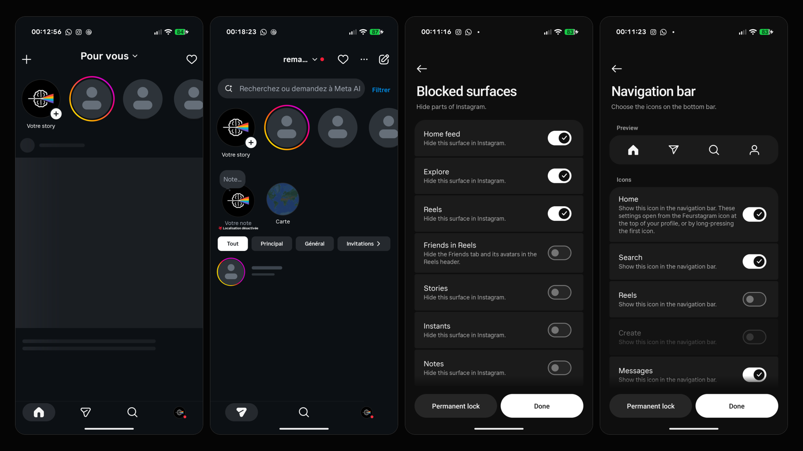
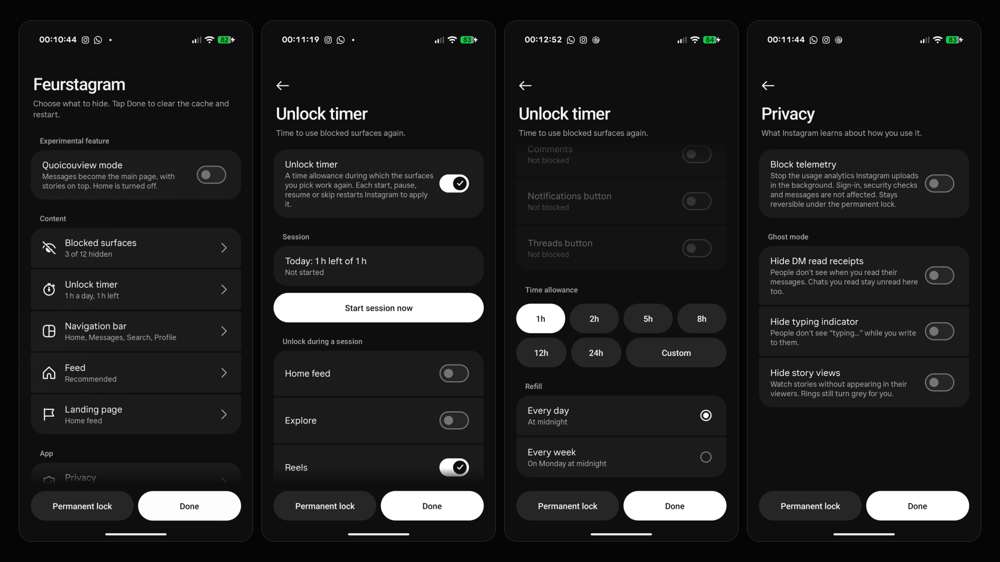

<div align="center">
  <h1></h1>
  <p><strong>Instagram without Reels, feed, Explore or ads.</strong></p>
  <p>
    Feurstagram is <a href="https://jean-voila.github.io/FeurStagram/instagram-without-reels/">Instagram without Reels</a>:
    an open-source patch for the official Android app that removes the feed,
    Reels, Explore and ads, while keeping DMs, stories, search,
    notifications and profiles.
  </p>
</div>

<p align="center">
  <a href="https://github.com/jean-voila/Feurstagram/releases/latest"></a>
  <a href="https://github.com/jean-voila/Feurstagram/releases/latest"></a>
  <a href="LICENSE"></a>
  <a href="https://discord.gg/Z9QvMw8s76"></a>
  <a href="https://www.instagram.com/feurstagram_off/"></a>
</p>

<p align="center">
  <a href="https://github.com/sponsors/jean-voila"></a>
  <a href="https://buymeacoffee.com/jean_voila"></a>
</p>
<p align="center">
  
</p>

<p align="center">
  <a href="https://github.com/jean-voila/Feurstagram/releases/latest"><strong>Download APK</strong></a>
  ·
  <a href="docs/INSTALL.md">Install</a>
  ·
  <a href="docs/BUILD_FROM_SOURCE.md">Build from source</a>
  ·
  <a href="docs/FAQ.md">FAQ</a>
  ·
  <a href="docs/PRIVACY.md">Privacy</a>
  ·
  <a href="https://github.com/sponsors/jean-voila">Support</a>
  ·
  <a href="https://buymeacoffee.com/jean_voila">Buy me a coffee</a>
  ·
  <a href="https://github.com/jean-voila/Feurstagram/issues">Issues</a>
</p>

## What it keeps and blocks

| Keep using Instagram for | Remove or block |
|--------------------------|-----------------|
| Direct Messages | Endless Home feed |
| Stories | Reels surfaces |
| Search and profiles | Explore and suggested-account recommendations |
| Notifications | Ads and suggested content |

## Preview

<p align="center">
  <a href="docs/assets/brand/screenshots.png"></a>
</p>

<p align="center">
  <a href="docs/assets/brand/settings-screenshots.png"></a>
</p>

## Is it safe?

Feurstagram does not collect, proxy, store, or transmit your credentials.

It patches the official Instagram Android app to remove distracting features. The patches are open source and documented, so you can inspect what is changed.

For maximum trust, you can build the APK yourself instead of downloading a prebuilt release.

That said, Feurstagram is an unofficial project and is not affiliated with Instagram or Meta. It is a modified APK installed outside the Play Store, so Android may show installation warnings. Using a modified client may violate Instagram's terms of service. Use it at your own risk.

## What Feurstagram does NOT do

Feurstagram does not:

- bypass Instagram login;
- collect your password or session tokens;
- proxy your traffic through a third-party server;
- add tracking or analytics;
- scrape accounts;
- sell or transmit user data;
- claim affiliation with Instagram or Meta.

## Why Feurstagram?

Unlike WebView-based alternatives, Feurstagram patches the real Android Instagram app.

Unlike accessibility-service blockers, it does not simply react to the interface after it loads.

Unlike closed-source Instagram mods, every patch is public and auditable.

Feurstagram is built for people who want to keep Instagram's useful social features without the addictive parts.

I built this project for myself as an alternative to DFInstagram which hasn't been maintained for a long time and was difficult to update. I'm sharing it so others can do the same for themselves.

**This project is entirely free and open-source.** Feel free to fork, copy, enhance, or submit pull requests - do whatever you want with it!

## Documentation

- [Installation guide](docs/INSTALL.md)
- [Build from source](docs/BUILD_FROM_SOURCE.md)
- [FAQ](docs/FAQ.md)
- [Unlock timer](docs/FAQ.md#how-does-the-unlock-timer-work)
- [Privacy](docs/PRIVACY.md)
- [Contributing](CONTRIBUTING.md)
- [Security policy](SECURITY.md)
- [Visual identity and asset sources](design/README.md)

## How do I get notified when there is a new update ?

Feurstagram checks GitHub for a newer release on every launch and shows a
download prompt when your build is out of date. This **automatic update check**
is on by default and can be turned off in the Feurstagram settings page
(Updates section).

There is also a story on **the official Feurstagram** account every time there
is an update. Feurstagram has moved to a **new account**, @feurstagram_off:

- https://www.instagram.com/feurstagram_off/

Just follow this account and you will get a new story on each release.

## Community

Join the Discord server to get support, follow updates, and discuss development:

- https://discord.gg/Z9QvMw8s76

## Contact

Official email: **[feurstagram@gmail.com](mailto:feurstagram@gmail.com)**. Journalists can find facts, screenshots and logos in the [press kit](https://jean-voila.github.io/FeurStagram/press/).

## Installation

You have two options:

1. **Ready-to-install APK** - Grab the latest patched APK from the [Releases](../../releases) page and install it directly
2. **DIY Patching** - Use the toolkit below to patch any Instagram version yourself

## What Gets Disabled

All content blocks are **individual runtime toggles** — tap the Feurstagram
icon at the top of your profile, next to the menu (or long-press the Home tab,
the first icon of the bar if you hid Home, Messages in Quoicouview mode; on
tablets, the same icons in the side rail) to open the Feurstagram settings page and check/uncheck what you
want blocked. A single APK covers every
combination.

| Feature | Default | Toggleable | How |
|---------|---------|------------|-----|
| **Home Feed** | Blocked | Yes | Response filtering |
| **Following feed only** | Off | Yes | Feed-request header rewrite |
| **Explore** | Blocked | Yes | Response filtering |
| **Reels** | Blocked | Yes | Response filtering + Tab hidden |
| **Stories** | Visible | Yes | Response filtering |
| **Suggested accounts** | Blocked | Yes | Response filtering + feed-parse filtering |
| **Instants (+ button in DMs)** | Blocked | Yes | View visibility hidden |
| **Notes (text bubbles above DMs)** | Blocked | Yes | Row removed from the inbox list |
| **Ads** (feed, Reels, Stories) | Blocked | Yes | Response filtering + feed-parse filtering |
| **Comments** (posts, Reels, stories) | Visible | Yes | UI state hooks + comment-list request cancelled |
| **Threads button (profile header)** | Hidden | Yes | View visibility hidden |
| **Analytics & telemetry** | Blocked | Yes (stays reversible under the permanent lock) | Upload requests cancelled |
| **Shopping / commerce preloads** | Native | No | Instagram requests preserved |

**Following feed only** is a softer alternative to blocking the Home Feed
entirely: leave the feed unblocked and turn this on to get a chronological feed
of just the accounts you follow, with the recommended/ranked posts dropped.


## What Still Works

| Feature | Status |
|---------|--------|
| **Direct Messages** | Works |
| **Profile** | Works |
| **Reels in DMs** | Works |
| **Search** | Works |
| **Notifications** | Works |
| **Deep links** | Works |

## Settings Page

**Tap the Feurstagram icon** (the diamond at the top of your own profile, just
left of the ☰ menu). A red dot on it means a new Feurstagram release is out; the
settings then open on an "Update available" row. The former gesture still works:
long-press the Home tab (or, if you hid the Home icon, the first icon left on
the bar). A full-screen, scrollable settings page opens — Material 3
Expressive, monochrome, and padded to fit around system bars and cutouts on any
device. It starts on an overview: one row per section, with Instagram's own
outline icon and a one-line summary of that section's current state (for
example "3 of 10 hidden"). Tapping a row opens the section's page in the same
window, with a back arrow; Back returns to the overview. The sections are:

- **Experimental feature: Quoicouview mode** (off by default) — Messages becomes
  the main page, with the stories tray at the top of the inbox, under its search
  bar, and the notifications button in its header, and Home is turned off. The
  story camera opens from the tray's "Your story" (+) or with a swipe to the
  right, as on Home. A card presents it once after the update, with a screenshot.

- **Blocked surfaces** — toggles for Home Feed, Explore, Reels, Stories,
  Suggested accounts, Ads, Comments, Instants, Notes, the notifications button and the
  Threads button of the profile header. *Comments* (off by default) removes comment
  buttons, counts, "View all comments" lines, the "Add a comment…" bar, the comment
  previews over stories and the story viewer's comment button; a direct link to
  comments opens the post without them.
- **Unlock timer** (off by default) — a time allowance, refilled every day (at
  midnight) or every week (Monday), during which the blocked surfaces you pick work
  again. Pick 1h, 2h, 5h, 8h, 12h, 24h or a custom duration; surfaces that are not
  blocked are greyed out. Start a session from the page; while it exists a pill shows
  the time left, starting at the top centre and draggable anywhere like an Android
  bubble. Tap it to open a card with *Pause* (blocks again, keeps the time) or
  *Resume*, and *Skip* (ends the session; what is left is lost until the next
  refill). Each start, pause, resume, skip and the end of the allowance clears the
  cache and restarts Instagram, so what the session loaded does not outlive it.
  Under the permanent lock the timer keeps working but can only be narrowed.
- **Navigation bar** — show or hide each bottom-bar icon (Home, Search, Reels,
  Create, Messages, Profile) independently of the content blocks, with a live
  preview of the bar above the toggles. A toggle for a tab your Instagram build
  does not have (451 has no Create tab) is greyed out. Hiding Home moves the
  settings gesture to the first icon left on the bar, and Instagram then opens
  on that icon instead of the hidden feed; Home stays if every other icon is
  hidden, so the settings remain reachable. A swipe that would
  land on a hidden tab carries straight on to the next visible one, so a hidden
  section stays hidden instead of being one flick away.
- **Feed** — *Following feed only*: restrict the Home Feed to accounts you
  follow (chronological), instead of the recommended feed. Has effect only when
  the Home Feed is left unblocked.
- **Privacy** — *Block telemetry* (on by default, after an update too): cancels
  Instagram's usage-analytics uploads (see [Telemetry blocking](#telemetry-blocking)).
  It is independent of the Ads block and stays reversible under the permanent lock.
  *Ghost mode* adds three independent options, all off by default: *Hide DM read
  receipts* (people don't get "Seen"; the chat stays unread on your phone too, and
  replying does not send a receipt), *Hide typing indicator* and *Hide story views*
  (you don't appear among a story's viewers; rings still turn grey for you). They are
  separate from telemetry blocking and not frozen by the permanent lock.
- **Display and popups** — *Force dark (disable HDR)* (on by default): stops Instagram
  forcing its window into HDR mode, which lifts the black floor and washes out
  the dark UI on HDR OLED screens. Turn it off to keep Instagram's HDR behaviour.
  *Instagram popups* (on by default) drops Instagram's own toasts, such as the
  native transient network-error messages. Content blocks no longer manufacture these errors.
  *Grayscale* (off by default) draws Instagram without colour: the interface, photos,
  Stories, Reels and feed videos, the gallery and every dialog or sheet. It is a
  display filter only (saved and shared files keep their colours) and applies to
  Instagram alone. Surfaces drawn outside the app's windows by the system keep their
  colours: the live camera preview and live broadcasts.
- **Landing page** — choose which surface the app jumps to on cold start
  (Home feed, Search, Direct messages, or Profile). A surface whose navigation
  icon is hidden can't be picked, and stops being used if you hide it later:
  landing on it would hand back exactly what you removed. Instagram then opens
  on the Home feed, or on the first icon of the bar if Home is hidden too.
- **Updates** — after an update, the first launch shows a **What's new** card with
  that version's release notes. Then, *Automatic update check* (on by default): on launch,
  Feurstagram checks GitHub for a newer release and, if your build is out of
  date, opens a page showing what changed in it. Choosing *Update* downloads the
  APK on a progress page you can cancel — or leave, in which case the download
  carries on in a notification — then hands it to Android's installer. No
  browser, no manual download. Turn the check off here if you'd rather look
  yourself.
- **Support** — opens the project's [GitHub Sponsors](https://github.com/sponsors/jean-voila) page.
- **Permanent lock** and **Done** buttons pinned at the bottom so they stay
  reachable on any screen size.

Changes persist across restarts (stored in SharedPreferences
`feurstagram_prefs`).

Once you change any setting, the page can only be left by restarting: both
**Done** and **Back** clear the cache and relaunch, so a changed block can
never leave the app in a half-applied state with stale content still loaded.
If you open the page and change nothing, Back simply closes it.

### Permanent lock

The permanent lock freezes your restrictions for this installation. It only
prevents *relaxing* them: you can still make settings **stricter** (turn a
block on), but you cannot turn a block back off without reinstalling. It also
freezes **Following feed only** once it is on, so the ranked feed cannot come back.

The freeze is captured per settings session, not the instant you flip a
switch. When you open the settings page, Feurstagram snapshots which surfaces
are currently blocked; only those stay frozen. A surface you turn on by
mistake during a session can still be turned back off **until you tap Done** —
Done clears the cache and restarts, which bakes the new state in as the next
snapshot. This means a stray tap on a surface (e.g. Stories) is recoverable
within the same session instead of forcing a reinstall.


## Requirements

- JDK 21 and the Android SDK (`ANDROID_HOME` set, build-tools installed)
- A GitHub token with the `read:packages` scope in `~/.gradle/gradle.properties`,
  used to fetch the patcher dependency:
  ```properties
  gpr.user=<your-github-username>
  gpr.key=<token-with-read:packages>
  ```

## Build from source

1. **Download an Instagram APK** from [APKMirror](https://www.apkmirror.com/apk/instagram/instagram-instagram/) (arm64-v8a recommended).

2. **Build and apply:**
   ```bash
   ./build.sh instagram.apk
   ```
   Add `--clone` to install Feurstagram **alongside** a stock Instagram (separate
   package and data), and `--install` to push it to a connected device:
   ```bash
   ./build.sh instagram.apk --clone --install
   ```
   The signed result is written to `feurstagram.apk`.

## Project structure

```
Feurstagram/
├── build.sh                      # Build the bundle and apply it to an APK
├── patches/                      # Patches (Kotlin): where to inject, by fingerprint
│   └── src/main/kotlin/com/feurstagram/patches/
│       ├── network/              # Response filtering + feed-item filter + following-feed
│       ├── settings/             # Settings entry points (tab bar) + Back history
│       ├── quoicouview/          # Stories tray as a row of the Direct inbox
│       ├── signature/            # Signing-cert trust bypass (deep links)
│       ├── display/              # Force SDR (disable Instagram's forced HDR window)
│       ├── debug/                # ADB settings bridge (dev only, --debug)
│       └── clone/                # Side-by-side package/label rename
└── extensions/                   # Runtime code (Java), compiled and merged in
    └── .../com/feurstagram/extension/
        ├── Block.java            # URI blocking rules + feed-item type filter
        ├── LimitFeed.java        # Following-feed header rewrite
        ├── Config.java           # SharedPreferences toggles + permanent lock
        ├── Settings.java         # Settings dialog
        ├── Display.java          # Window colour-mode control (Force dark / SDR)
        ├── Hiders.java           # Nav-tab / Notes / Instants hiders + landing redirect
        ├── HiddenTabSwipeSkipper.java  # Keeps swipes off hidden tabs' pages
        ├── Quoicouview.java      # Quoicouview mode: inbox row hooks + story launch
        ├── StoriesTrayRow.java   # The inbox row type that holds the stories tray
        ├── QuoicouviewIntro.java # One-time card presenting Quoicouview mode
        ├── DebugBridge.java      # Dev-only ADB bridge over the settings (--debug builds)
        └── UpdateChecker.java    # On-launch GitHub release check
```

## Design

Feurstagram's own screens follow Material 3 Expressive in a monochrome dark scheme —
white is the only accent, and everything is built in code because the mod has no
resources of its own. The tokens, shapes, type scale, component rules and the
window-inset requirements are written down in [docs/DESIGN.md](docs/DESIGN.md); read it
before changing or adding any UI.

## Signing

The bundle is signed during `build.sh`. Set `FEURSTAGRAM_KEYSTORE_PASS` (and
optionally `FEURSTAGRAM_KEY_PASS`) to sign with `feurstagram.keystore`;
otherwise a throwaway keystore is generated. Reuse the same keystore across
builds to install updates without uninstalling first.

## Debugging

Blocked requests surface as `java.io.IOException: Blocked by Feurstagram` in
logcat:
```bash
adb logcat | grep "Blocked by Feurstagram"
```

## How It Works

Patches locate their injection points by **fingerprint** (matching code by
stable traits like class names, strings and method shapes) rather than by
obfuscated names, so they keep applying across Instagram updates. The runtime
logic lives in compiled extension classes that are merged into the app.

### Settings Hook
A fingerprint matches the main tab-bar binder and injects a watcher on it. The
watcher adds a Feurstagram button to the header of the user's own profile (the
one with the "Create" button on its left), just before the menu button, and puts
it back on any layout pass where Instagram rebuilt the header; it carries the red
update dot. It also resolves the
tab ids via `Resources.getIdentifier(...)`, grabs the Home tab (or the first
visible tab when Home is hidden) once laid out, and installs a long-press
listener. Either one
opens a full-screen Material dark page: content toggles plus a landing-page
selector, all backed by `SharedPreferences` (`feurstagram_prefs`). The same
hook installs the navigation-tab/Notes/Instants hiders, the hidden-tab swipe
skipper and the cold-start landing-page redirect.

### Quoicouview mode
When Quoicouview is enabled or Notes are blocked, the Direct inbox uses Instagram's
view-based list renderer, including on accounts assigned the fully Compose inbox.
The renderer choice is applied both to view setup and data delivery.
The list uses an `IgRecyclerViewAdapter`: a list of models, each drawn by
the row type registered for its class. The patch registers one more row type,
`StoriesTrayRow`, in every such adapter (it is made a subclass of Instagram's
obfuscated row and holder base classes at patch time), and hooks the adapter's
list updates so the inbox's list gets the stories row right after its search
bar (the search bar's obfuscated list models are found at patch time). The row holds the
feed's own stories tray: Instagram keeps every tab's page alive, so the feed
keeps the tray up to date while it is drawn in the inbox. A tap opens the story
exactly as on Home, growing out of the avatar and shrinking back into it on
close: the feed tray controller's "is the feed visible" checks accept the tray
in the inbox, and the controller, a lifecycle listener of the feed fragment,
follows the inbox's resume and pause instead, together with its data controller.
Returning to Messages runs Instagram's client-side story sort, and pulling to
refresh also requests new stories. The viewer is added over the
inbox rather than replacing it, so closing it does not wait for the inbox to be
rebuilt. The feed header's notifications
button is moved to the inbox header the same way. The story camera is the swipe
navigation's panel left of the tab pages, which Instagram only turns on, and only
lets a swipe from the main page reach, while Home is the current tab: both "is
Home current" checks of the tab controller accept Messages, and the tab pager
tells the swipe navigation it cannot scroll onto the hidden pages left of
Messages, so the tray's "Your story" (+) and a swipe to the right open the camera. A third patch keeps the hidden
Home out of the tab Back history. Instagram has several main layouts, picked per
account and sometimes per launch: the mode answers the override they all read
first, so it always gets the one with a tab pager and a Messages tab. The pager's
pages load when first shown, so the feed's page is told to load right away, for
launches that do not start on Home.

### Content response filtering
Instagram sends requests through its own Tigon transport, with its own authentication,
parameters, scheduling and retries. Feurstagram no longer throws a network error to
hide a surface. After a successful response arrives, an incremental JSON filter
empties the root content lists for surfaces the user blocked, retaining metadata and
security messages. Pagination flags for an emptied surface are disabled locally to
avoid repeated automatic load-more requests. The full response still crosses the
network; it is not displayed, and media URLs removed from the response are not fetched
just to imitate a view.

The filter handles UTF-8, nested objects, escaped strings and arbitrary transport
chunk boundaries without buffering a full response. Non-success HTTP responses pass
through unchanged. Parse hooks also suppress home feed units and story-tray entries.

### Telemetry blocking
With **Block telemetry** on (the default, *Privacy* page of the settings), the
requests that upload Instagram's usage analytics are cancelled as they start, the
way a network failure would: the Pigeon/Falco event batches (`/pigeon_nest`,
`/logging_client_events` on graph.instagram.com and graph.facebook.com), the
experiment-exposure log (`/launcher/mobileconfiglogging/`), activity-feed impression
logs (`/news/log/`) and Meta's ad-measurement pixel loaded into the in-app browser
(`/fbevents.js`). Nothing else is cancelled: sign-in, two-factor, integrity and
security checks, configuration, uploads, messages and every content request keep
Instagram's native behaviour, and read receipts and story views are left to the
ghost-mode options. The toggle is independent of **Ads** and is not frozen by the
permanent lock. Turning it off restores Instagram's own telemetry.

Feurstagram adds no synthetic views, interactions, heartbeat requests or background
polling. This does not establish why an account was restricted, and does not
guarantee protection from restrictions.

### Feed Item Filtering
Endpoint selection alone cannot separate ads and "suggested" units that Instagram injects
**inline** into the Home Feed payload — they arrive inside the normal
`/feed/timeline/` response, not on a separate URL. A second fingerprint matches
the feed-item JSON deserialiser (by the stable wire-format type tokens like
`clips_netego` and the `parseFromJson` method name) and rewrites a blocked
unit's type token to an invalid one. Instagram's own parser then routes it to
its "unknown FeedItem type" branch and drops it — no crash. Ad/promo units are
gated on the **Ads** toggle, suggested/netego units on the **Suggested
accounts** toggle.

### Following Feed Only
A fingerprint matches the main-feed request class (by its debug-string shape)
and rewrites the request's `pagination_source` header from the recommended feed
to `following`, so the Home Feed returns only accounts you follow. The header
field is obfuscated, so it is resolved dynamically each build rather than
hardcoded. Gated on the **Following feed only** toggle.

### Deep-link signature bypass
Instagram checks that the running APK is signed by Meta before it follows a deep
link into its own content. A re-signed FeurStagram build fails that check, so
shared links (posts, reels, profiles) silently dropped to the home feed. A patch
adds FeurStagram's own signing key to Instagram's two signing-certificate trust
checks, so it treats the build as genuine and deep links resolve normally. Every
other app keeps Instagram's answer: trusting every key made the Android share
sheet look like a Meta app, which Instagram's "share externally" scope removes
(#182). It matches on a stable
error string rather than obfuscated names, so it needs no per-version
maintenance. Fixes #36 and #106.

### Grayscale
Each window of the app (activities, dialogs, sheets, popups) is drawn into a
hardware layer whose paint holds a zero-saturation colour matrix; new windows are
caught as Android's window manager records them. Instagram's video player normally
renders on a `SurfaceView`, whose pixels never pass through the window, so while
Grayscale is on the player is sent down its own "enforce texture view" path
(`getEnforceTextureView`, an unobfuscated name), which the filter covers. The camera
preview and live video stay on a `SurfaceView` and keep their colours. Measured on a
Pixel over six Reels swipes: frame time p50 5 → 7 ms, p90 10 → 15 ms, janky frames
3.8 % → 4.1 %.

### Force SDR display
Instagram switches its window into HDR mode at runtime (server-gated per
account), which lifts the black floor on HDR OLED panels and leaves the flat dark
UI looking washed out for no benefit. A patch reroutes every window colour-mode
change through an extension helper that pins the window to SDR when the **Force
dark** toggle is on (default), keeping blacks deep; turning it off passes
Instagram's original colour mode through untouched. It hooks the framework
`Window.setColorMode` call, so it too needs no per-version maintenance.

Suggested accounts mixed into the story tray are not a separate request: they arrive as
`reel_type: "suggested_user"` entries of the tray response itself. A parse-layer hook drops
them when *Suggested accounts* is blocked, the same way feed ads are filtered.
`/discover/surface_with_su/` is deliberately left alone: the same response carries a
profile's mutual followers, and the "Mutual" tab of its follower lists never loads once
the suggestions in it are emptied.

#### Content response paths (requests remain enabled)

| Path / pattern | Purpose | Toggleable |
|----------------|---------|------------|
| `/feed/timeline/` | Home feed posts | Yes |
| `/feed/reels_tray` | Stories tray | Yes |
| `/discover/topical_explore` | Explore tab content | Yes |
| `/clips/home/`, `/clips/discover`, `/clips/get_blend_medias/` | Reels feed + discovery + Blend reels | Yes |
| `/discover/ayml/`, `/discover/sectioned_ayml/`, `/discover/chaining/`, `/discover/recommended_accounts_for_category/`, `/discover/suggested_businesses/`, `/discover/recs_from_friends_suggestions/`, `/discover/recs_from_friends_user_info/`, `/discover/fetch_suggestion_details/`, `/discover/account_discovery/`, `/discover/reshare_suggestions/`, `/fbsearch/accounts_recs/`, `/friendships/feed_favorites_suggestions/`, `/friendships/share_to_friends_story_suggested_users/`, `/direct_v2/search_friending_suggestions/`, `/business/discovery/suggest_business/` | Suggested-account recommendations (profile "Suggested for you", stories-tray injected accounts, search null-state recs, post-follow chaining, friend/business suggestions) | Yes |
| `/api/v1/ads/` (all `ads/*`, including `async_ads`, the ads injected between Reels and Stories), `/feed/injected_reels_media*` (story ads), `/feed/async_ads_ranking/`, `/feed/shop_everything_feed_of_ads*`, `/feed/user_interests_contextual_feed_of_ads/`, `/discover/chaining_experience_contextual_ads/`, `/discover/chaining_experience_notification_ads/`, `/direct_v2/ads_for_ctd_ads_thread_view/`, `/direct_v2/should_show_ad_responses_tab/`, `/profile_ads/get_profile_ads/`, `/stories/stories_high_intent_discovery_ads/`, `/stories/stories_intent_aware_ads/`, `/commerce/product_collections/ads_collection_page/` | Sponsored ads injected into the feed, stories, profile, DMs, Explore chaining and commerce | Yes |
Note: despite the name, `/feed/reels_tray` is the stories tray endpoint in Instagram internals.

Content selection is restricted to Instagram hosts and uses `String.contains()` on the URI path. Instagram changes URL shapes over time; adjust the rules in `extensions/.../Block.java` if a block stops matching.

### Feurstagram release revisions

A numeric suffix such as `v455-0-0-51-72-1` identifies a new patch release on the
same Instagram base. `ReleaseVersion` maps that base to the revised updater identity;
Instagram's package version and network identity remain unchanged. When preparing
another revision, update that mapping. Other Instagram bases keep their original
release identity until explicitly revised.

## Updating for New Instagram Versions

Because patches are fingerprint-based, a new Instagram version usually just
needs a rebuild (`./build.sh <new-instagram.apk>`). If Instagram restructures a
targeted area, only the affected fingerprint needs adjusting.


## Contributing

This is a personal project I'm sharing with the community. Contributions are welcome!

- 🍴 **Fork it** - Make your own version
- 🔧 **Pull requests** - Improvements and fixes are appreciated
- 📋 **Copy it** - Use the code however you want
- ✨ **Enhance it** - Build something even better

## License

This project is released under the GNU General Public License v3.0. See [LICENSE](LICENSE) for details.

Built with the [Morphe](https://morphe.software) patcher and adapts Instagram
patch ideas from [Piko](https://github.com/crimera/piko), both GPLv3. See
[NOTICE](NOTICE) for attribution. Feurstagram is an independent project, not
affiliated with or endorsed by Morphe or Piko.
